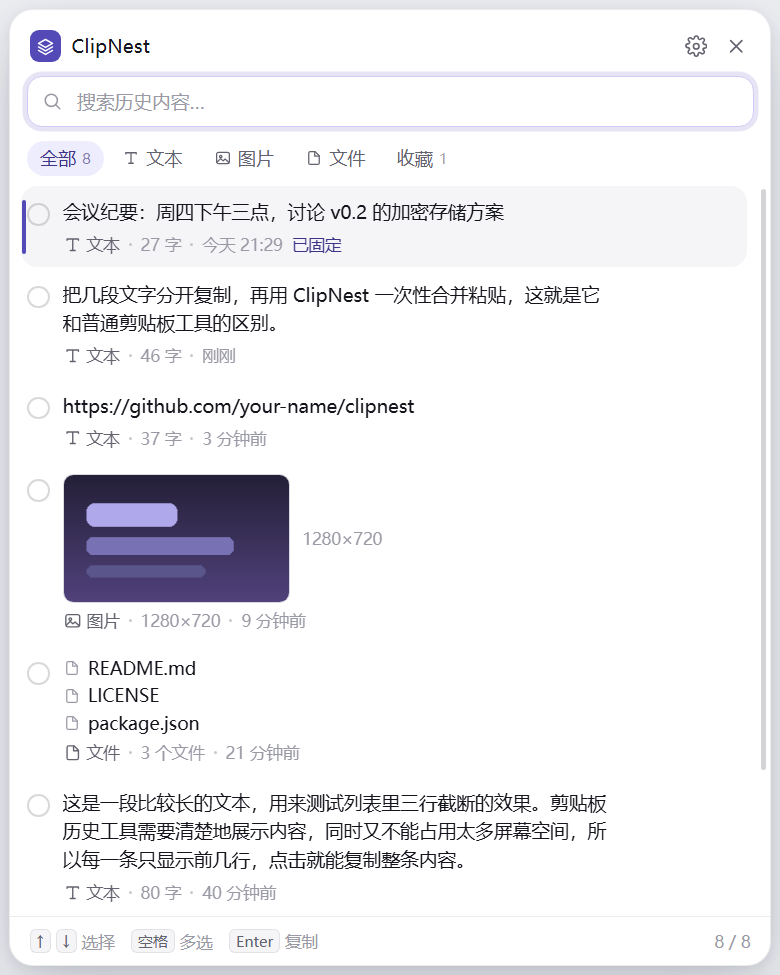

# ClipNest

一个贴在屏幕边上的剪贴板历史工具。它记录你复制过的文字、图片和文件，需要的时候把几条一起勾出来，一次粘进去。

> 大部分剪贴板工具解决的是「找回来」；ClipNest 多解决一步「凑起来」。



---

## 它和别的剪贴板工具差在哪

普通剪贴板工具：找到一条 → 复制 → 粘贴 → 回到工具 → 找到下一条 → 复制 → 粘贴。

ClipNest：勾选三条 → 合并复制 → 回到目标窗口按一次 `Ctrl+V`。

合并出来的内容按你在列表里的顺序拼接，可以用换行、空行、空格或直接相连。

## 功能

- **贴边小条**：常驻屏幕右边缘，鼠标移上去自动展开，移开自动收起，不占任务栏
- **全局快捷键**：默认 `Ctrl+Shift+V`，可改成任意组合
- **多选批量粘贴**：点筛选行右侧的「多选」，之后单击条目就是勾选；可以「全选」或 `Ctrl+A`，再合并复制或依次粘贴
- **一键清理**：标题栏的垃圾桶按钮，点两下清空（防误删），收藏的条目会保留
- **富内容支持**：纯文本、HTML 富文本、图片，以及从资源管理器复制的文件
- **截图自动当图片**：截图工具往往把 `.png` 文件塞进剪贴板，ClipNest 会认出它是图片、生成缩略图并归到「图片」分类
- **点开看大图**：点图片缩略图弹出预览，可以用系统看图程序打开，或直接复制
- **搜索与筛选**：实时搜索内容，按文本 / 图片 / 文件 / 收藏筛选
- **固定收藏**：重要的条目钉在顶部，不会被自动清理
- **隐私控制**：忽略关键词、单条字数上限、暂停记录、一键清空
- **纯本地**：不联网、不上传、无账号

## 安装

### 直接下载

到 [Releases](https://github.com/your-name/clipnest/releases) 下载对应系统的安装包：

| 系统 | 文件 |
| --- | --- |
| Windows | `ClipNest-x.y.z-x64.exe` |
| macOS | `ClipNest-x.y.z.dmg` |
| Linux | `ClipNest-x.y.z.AppImage` |

### 从源码运行

需要 Node.js 20 以上。

```bash
git clone https://github.com/your-name/clipnest.git
cd clipnest
npm install
npm run dev
```

打包安装包：

```bash
npm run dist        # 当前平台
npm run dist:win    # 指定 Windows
```

## 使用

1. 启动后，屏幕右边缘会出现一条竖着的小条，上面显示已记录的数量。
2. 正常复制东西，它会自己记录。
3. 鼠标移到小条上，面板展开；或者随时按 `Ctrl+Shift+V` 唤起。
4. 单击某条 = 复制这一条；单击左侧圆圈 = 勾选，可以勾多条。
5. 图片条目的缩略图可以点开看大图，预览里能直接复制，或交给系统看图程序打开。
6. 勾选后底部会出现操作栏：**合并复制** 或 **依次粘贴**。

### 两种批量方式怎么选

| | 合并复制 | 依次粘贴 |
| --- | --- | --- |
| 原理 | 把选中内容拼成一段，写进剪贴板 | 逐条写剪贴板并模拟按下 `Ctrl+V` |
| 你还需要做什么 | 回到目标窗口按一次 `Ctrl+V` | 无需操作，但要把光标先点进目标输入框 |
| 适合 | 几段文字要一起贴到聊天窗口、文档里 | 填表格、一栏一栏地粘贴 |
| 限制 | 图片不能参与合并（系统剪贴板只放得下一张图） | 部分程序会拦截模拟按键，或粘贴到错误的焦点 |

依次粘贴依赖系统级的按键模拟：Windows 用 PowerShell `SendKeys`，macOS 用 `osascript`，Linux 需要 `xdotool`。这是实验性功能，第一次用建议先拿记事本试。

## 键盘操作

| 按键 | 作用 |
| --- | --- |
| `Ctrl+Shift+V` | 全局唤起 / 收起面板（可在设置里改） |
| `↑` `↓` | 上下移动选中项 |
| `空格` | 勾选 / 取消勾选当前项 |
| `Enter` | 复制当前项（或有勾选时复制全部勾选项） |
| `Delete` | 删除当前项 |
| `Ctrl+A` | 全选当前筛选结果 |
| `Esc` | 退出多选 / 收起面板 |

## 数据存在哪

全部数据都在本机用户目录里，纯文本 JSON + 图片文件，没有任何网络请求：

| 系统 | 路径 |
| --- | --- |
| Windows | `%APPDATA%\ClipNest` |
| macOS | `~/Library/Application Support/ClipNest` |
| Linux | `~/.config/ClipNest` |

```
history.json     历史记录（纯文本，可用任意编辑器打开）
settings.json    设置
images/          图片与缩略图
```

设置里有「打开目录」按钮可以直接跳过去。删除这个文件夹 = 彻底清空。

**注意**：历史记录默认是明文的。如果你会复制密码、密钥、身份信息，建议在设置里把关键词（如 `password`、`token`）加进「忽略关键词」，或者临时开启「暂停记录」。

## 已知限制

- 剪贴板靠轮询检测（默认 420ms 一次），连续极快地复制两次可能漏掉一次
- 从资源管理器复制的文件，回填剪贴板依赖 PowerShell 的 `Set-Clipboard`，非 Windows 平台会退化成路径文本
- 依次粘贴在 Linux 上需要自行安装 `xdotool`
- 不支持来源应用识别（「不记录来自密码管理器的内容」这类规则暂未实现）

### 启动后窗口没出现 / 立刻退出

某些受限环境（远程桌面、部分虚拟机、带进程沙箱的终端）会让 Chromium 的 GPU 进程启动失败，日志里出现 `GPU process isn't usable. Goodbye.`。用下面的方式启动可以绕过：

```bash
npx electron . --no-sandbox
```

正常桌面环境不需要加这个参数。

## 开发

```
electron/
  main.cjs       主进程：窗口形态、托盘、快捷键、IPC
  watcher.cjs    剪贴板轮询与内容识别
  store.cjs      历史与设置持久化
  paste.cjs      剪贴板写入与按键模拟
  preload.cjs    contextBridge 暴露的 API
src/             React 渲染层
scripts/         开发脚本
  dev.mjs            vite + electron 联合启动
  preview.cjs        用假数据渲染界面并截图，不碰系统剪贴板
  probe-clipboard.cjs 打印当前剪贴板的所有 MIME 类型，排查平台差异用
  make-icons.py      用 Pillow 重新生成图标
```

技术栈：Electron + React + TypeScript + Vite。没有任何原生模块，`npm install` 之后直接能跑。

```bash
npm run dev       # 开发模式，改渲染层代码会热更新
npm run preview   # 用 mock 数据渲染面板，输出 .preview-list.png
npm run dist      # 打包当前平台
```

需要给 Electron 传额外参数时，用 `CLIPNEST_ELECTRON_ARGS`：

```bash
CLIPNEST_ELECTRON_ARGS="--no-sandbox --no-proxy-server" npm run dev
```

如果 `npm run dev` 起来之后看不到窗口，多半是开发服务器被系统代理拦了——加 `--no-proxy-server` 即可（打包后的应用不联网，不受影响）。

Windows 上也可以直接双击项目根目录的 `dev.bat`，它会带着参数启动并保持窗口。`

几个实现上的注意点，改代码前值得知道：

- Electron 45 起 `clipboard` 换成了 W3C 风格的异步 API（`read()` / `write(ClipboardItem[])`），旧的 `availableFormats`、`readBuffer` 已经不存在了
- 剪贴板没有 `changed` 事件，只能轮询；间隔在 `watcher.cjs` 里，默认 420ms
- 透明度窗口在某些虚拟机和远程桌面里需要 `--disable-gpu` 才能正常显示
- Linux 上的「依次粘贴」依赖 `xdotool`

## 路线图

- [ ] 条目内搜索高亮与正则
- [ ] 图片 OCR，让截图也能被文字搜到
- [ ] 加密存储（可选口令解锁）
- [ ] 剪贴板内容来源应用识别与规则
- [ ] 分组与标签
- [ ] 多设备同步（自建，非云）

## 许可

[MIT](LICENSE)

---

## English

ClipNest is a clipboard history manager that lives in a thin strip on the edge of your screen. It records text, images and files you copy, and lets you tick several entries and paste them all at once — either merged into one block, or replayed one by one.

Cross-platform (Windows / macOS / Linux), built with Electron + React + TypeScript, no native modules, no network access, MIT licensed.
