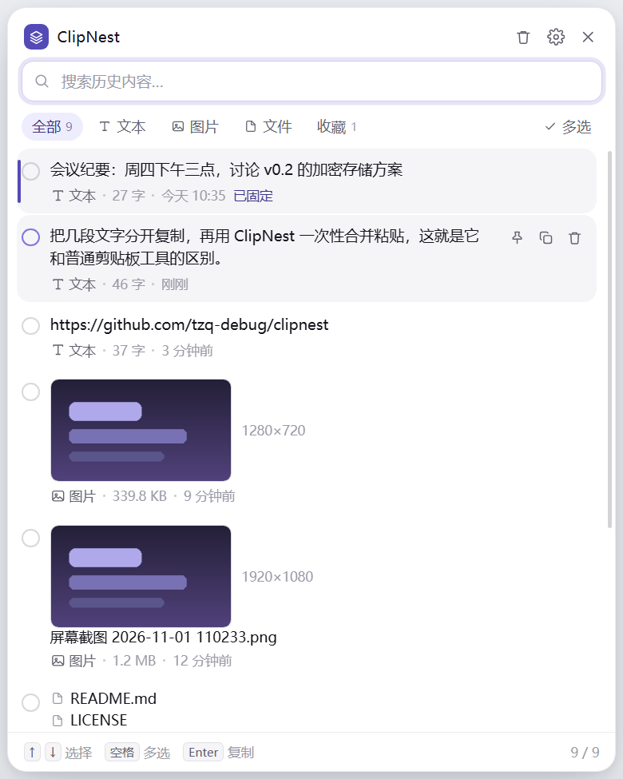
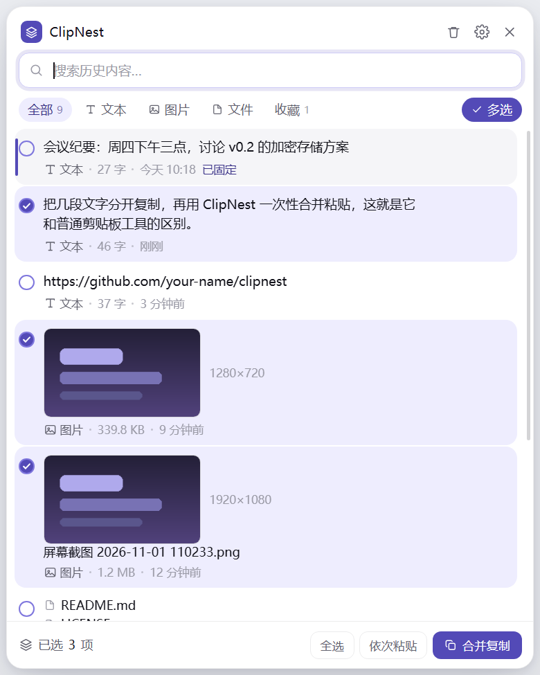

# ClipNest

**贴在屏幕边缘的剪贴板管理器 —— 而且能把好几条一起粘出去。**

[English](README.md) · [简体中文](README.zh-CN.md)




---

## 它和别的剪贴板工具差在哪

大部分剪贴板工具解决的是「找回来」。ClipNest 多解决一步：**把几条凑起来，一次粘出去。**

> 普通剪贴板工具：找到一条 → 复制 → 粘贴 → 回到工具 → 找到下一条 → 复制 → 粘贴。
>
> ClipNest：勾选三条 → **合并复制** → 回到目标窗口，按一次 `Ctrl+V`。

合并出来的内容按你在列表里看到的顺序拼接，分隔符可以选换行、空行、空格或直接相连。

<details>
<summary>多选模式长什么样</summary>



</details>

## 功能

- **贴边小条**：常驻屏幕右边缘，**点一下才展开**——鼠标只是路过不会弹出来，不占任务栏
- **停在你放的位置**：不点「收起」或「隐藏」它就一直在，按住标题栏可以拖到屏幕任意位置，下次启动还在那儿
- **全局快捷键**：默认 `Ctrl+Shift+V`，可改成任意组合
- **多选批量粘贴**：点筛选行右侧的「多选」，之后单击条目就是勾选；可以「全选」或 `Ctrl+A`，再合并复制或依次粘贴
- **什么都能记**：纯文本、HTML 富文本、图片，以及从资源管理器复制的文件
- **截图自动当图片**：截图工具往往把 `.png` 文件塞进剪贴板，ClipNest 会认出它是图片、生成缩略图并归到「图片」分类
- **点开看大图**：点缩略图弹出预览，可以用系统看图程序打开，或直接复制
- **把截图拖进聊天窗口**：按住缩略图拖到微信、飞书或文件夹，对方收到的是真实文件，不是剪贴板里的数据
- **把文件拖进来**：从资源管理器把文件拖到面板上就进历史，图片自动出缩略图，不用先复制
- **导出**：一个按钮把历史写成 Markdown（发给人看）或 JSON（完整备份，带收藏/置顶标记），图片会存到同目录的子文件夹
- **搜索与筛选**：实时搜索内容，按文本 / 图片 / 文件 / 收藏筛选
- **收藏和置顶是两件事**：收藏（★）进「收藏」筛选、清空时保留；置顶（📌）只把它排到列表最前
- **一键清理**：标题栏的垃圾桶，底部弹出确认条，点「确认清空」后只保留收藏的条目——置顶的照样清掉（置顶只管排序）
- **可选加密**：设一个口令，历史和所有图片用 AES-256-GCM 加密，每次启动都要解锁
- **密钥单独保护**：API 密钥、私钥、JWT、身份证、银行卡会被识别出来，用系统密钥加密后在列表里打码，不需要设口令
- **手动加密单条**：任何文本条目都能点锁加密，列表打码、复制照常，不管它像不像密钥
- **纯本地**：不联网、不上传、无账号

## 安装

| 系统 | 下载 |
| --- | --- |
| Windows | [安装版 `ClipNest-x.y.z-x64.exe`](https://github.com/tzq-debug/clipnest/releases/latest) · [绿色版 `ClipNest-x.y.z-x64.zip`](https://github.com/tzq-debug/clipnest/releases/latest) |
| macOS | 从源码构建（暂未提供 `.dmg`） |
| Linux | 从源码构建（暂未提供 `.AppImage`） |

Windows 安装包没有代码签名，SmartScreen 会拦一下，点「更多信息 → 仍要运行」。

绿色版不需要安装：解压到任意位置，双击 `ClipNest.exe` 即可。历史仍存在 `%APPDATA%\ClipNest`，和安装版共用同一份数据，两边可以随时切换。

### 从源码运行

需要 Node.js 20 以上。

```bash
git clone https://github.com/tzq-debug/clipnest.git
cd clipnest
npm install
npm run dev
```

打包安装包：

```bash
npm run dist        # 当前平台
npm run dist:win    # 指定 Windows
```

## 使用

1. 启动后，屏幕右边缘正中间会出现一条深紫色小条
2. 正常复制东西，它会自己记录
3. 鼠标移到小条上展开，或随时按 `Ctrl+Shift+V` 唤起
4. 单击某条 = 复制这一条；单击左侧圆圈 = 勾选
5. 勾选几条后，底部操作栏里选 **合并复制** 或 **依次粘贴**

### 键盘操作

| 按键 | 作用 |
| --- | --- |
| `Ctrl+Shift+V` | 全局唤起 / 收起面板（可在设置里改） |
| `↑` `↓` | 上下移动选中项 |
| `空格` | 勾选 / 取消勾选当前项 |
| `Enter` | 复制当前项（有勾选时复制全部勾选项） |
| `Ctrl+A` | 全选当前筛选结果 |
| `Delete` | 删除当前项 |
| `Esc` | 退出多选 / 关闭预览 / 收起面板 |

### 两种批量方式怎么选

| | 合并复制 | 依次粘贴 |
| --- | --- | --- |
| 原理 | 把选中内容拼成一段，写进剪贴板 | 逐条写剪贴板并模拟按下 `Ctrl+V` |
| 你还需要做什么 | 回到目标窗口按一次 `Ctrl+V` | 无需操作，但要把光标先点进目标输入框 |
| 适合 | 几段文字要一起贴到聊天窗口、文档里 | 填表格、一栏一栏地粘贴 |
| 限制 | 图片不能参与合并（系统剪贴板只放得下一张图） | 部分程序会拦截模拟按键 |

依次粘贴依赖系统级按键模拟：Windows 用 PowerShell `SendKeys`，macOS 用 `osascript`，Linux 需要 `xdotool`。这是实验性功能，第一次用建议先拿记事本试。

## 数据存在哪

全部数据都在本机，纯文本 JSON + 图片文件，项目里没有任何网络请求代码。

| 系统 | 路径 |
| --- | --- |
| Windows | `%APPDATA%\ClipNest` |
| macOS | `~/Library/Application Support/ClipNest` |
| Linux | `~/.config/ClipNest` |

```
history.json     历史记录（纯文本，可用任意编辑器打开）
settings.json    设置
images/          图片与缩略图
```

设置里有「打开目录」按钮可以直接跳过去。删除这个文件夹 = 彻底清空。

### 加密

历史默认是明文 JSON。如果不想让它躺在硬盘上被人直接打开，去 **设置 → 隐私 → 加密历史** 设一个口令：

- 文本、文件路径、所有存下来的图片都会用 AES-256-GCM 加密
- 密钥用 scrypt 从你的口令推导，硬盘上只留一个随机盐和一个校验值
- 每次启动都要输口令才加载数据，解锁之前连剪贴板监听都不会启动
- **没有找回渠道**。口令忘了，历史就永久没了——这是加密的代价
- 用口令可以再关掉，数据会解密回明文文件

日常防住敏感内容其实不需要加密：**忽略关键词** 和 **暂停记录** 已经能拦住密码这类东西。加密防的是「别人拿到了你的文件夹」。

### 敏感内容

除了整库加密，ClipNest 还会单独盯着「像密钥的东西」：

| 识别类型 | 例子 |
| --- | --- |
| API 密钥 | `sk-…`、`ghp_…`、`AKIA…`、`xoxb-…`、`sk_live_…` |
| 私钥 | `-----BEGIN … PRIVATE KEY-----` 开头的整块 |
| JWT | 三段点分的 base64url |
| 证件与卡号 | 18 位身份证号、通过 Luhn 校验的银行卡号 |
| 账号口令 | `password: …`、`API_KEY=…`、`secret=…` |

默认处理方式是 **加密并打码**：内容用系统密钥（Windows 走 DPAPI、macOS 走 Keychain）加密，只有你当前登录的账户能解开；列表里只显示类型和字符数，看不到内容。复制时照常可用，解密发生在写剪贴板的那一刻。硬盘上没有明文，也不需要设任何口令。

如果你连留都不想留，把 **设置 → 隐私 → 处理方式** 改成「直接不记录」。

### 手动加密某一条

识别只认「像密钥的东西」。其他你不想让它明晃晃躺在列表里的内容——一段笔记、一个地址、客户编号——可以自己锁起来：鼠标移到文本卡片上，点那把锁。

这一条会用同样的系统密钥加密，卡片上显示「手动加密 · 123 字符」而不是正文，复制时仍然拿得到完整内容。再点一次锁就恢复成明文。图片和文件条目不能用这种方式锁，那种情况请开整库加密。

识别是基于模式的，不是保证。夹在一大段文字里的密钥可能漏掉——整库加密和忽略关键词才是更外的两层防线。

### 导出

标题栏的下载按钮会把历史写到你自己选的位置：

- **Markdown**：一条一段，带时间、标记和正文。图片不内嵌 base64，而是写进同级的 `…_images/` 文件夹——文件不会膨胀，连着文件夹一起发出去也能正常显示
- **JSON**（设置 → 导出备份）：所有字段，包括收藏和置顶，用来存档或换机

加密封条目只导出成 `[已加密内容]` 加字符数，明文不会离开程序。某张图片读不出来就跳过那一张，不会让整次导出失败。

有勾选时就只导出勾选的几条。

## 已知限制

- 剪贴板靠轮询检测（默认 420ms 一次），连续极快地复制两次可能漏掉一次
- 从资源管理器复制的文件，回填剪贴板依赖 PowerShell 的 `Set-Clipboard`，非 Windows 平台会退化成路径文本
- 依次粘贴在 Linux 上需要自行安装 `xdotool`
- 不支持来源应用识别（「不记录来自密码管理器的内容」这类规则暂未实现）
- 拖拽只支持图片。纯文本没有文件可以交给别的程序，那种情况还是复制粘贴

## 常见问题

**点了一条，粘出来却是上一条？**
装 0.2.0 或更新的版本。0.1.0 有个 bug：点任何条目复制的都是列表最顶上那条。

**图片复制后粘到聊天软件里什么都没有？**
图片副本现在同时携带位图和文件，两种目标都认。如果某个具体软件仍然没反应，提个 issue 告诉我软件名。

**启动后看不到紫色小条？**
多半是已经有一个实例在跑（只允许一个）。另外在某些受限环境（虚拟机、远程桌面、沙箱终端）里 Chromium 的 GPU 进程会失败，用 `ClipNest.exe --no-sandbox` 启动可以绕过。

**`Ctrl+Shift+V` 和浏览器的「粘贴为纯文本」冲突了？**
所以快捷键可以改：设置 → 快捷键 → 按下你想要的组合。

**会偷偷联网吗？**
不会。没有统计、没有更新检查、没有账号。

## 参与开发

```
electron/            主进程（纯 CommonJS，不需要编译）
  main.cjs             窗口形态、托盘、全局快捷键、IPC
  watcher.cjs          剪贴板轮询与内容识别
  store.cjs            历史与设置持久化
  vault.cjs            可选加密（AES-256-GCM）
  sensitive.cjs        密钥/证件等敏感内容识别
  export.cjs           导出 Markdown / JSON（纯函数）
  drag.cjs             判断一次拖拽该带上哪个文件
  paste.cjs            剪贴板写入与按键模拟
  preload.cjs          contextBridge 暴露给渲染层的 API
src/                 渲染层（React + TypeScript）
scripts/             开发期脚本，不进安装包
assets/              运行时资源：应用图标、托盘图标
build/               打包用图标
docs/                文档截图
```

Electron + React + TypeScript + Vite，没有任何原生模块，`npm install` 之后直接能跑。

```bash
npm run dev        # 开发模式，渲染层热更新
npm run typecheck  # tsc --noEmit
npm run preview    # 用 mock 数据渲染界面并截图
npm run dist       # 打包当前平台
```

Windows 上也可以直接双击项目根目录的 `dev.bat`。

没有测试框架，但大部分行为都有断言脚本兜着：

```bash
npm test          # 类型检查 + 下面全部探针
npm run test:app  # 只跑需要真实 Electron 运行时的那几个
```

每个探针逐条输出 `PASS` / `FAIL`，失败时退出码非零。`probe-export`、`probe-drag` 是纯 node（它们覆盖的模块刻意不依赖 Electron）；`probe-vault`、`probe-sensitive`、`probe-seal` 需要启动 Electron，因为要碰 `safeStorage`。`npm run preview` 用假数据渲染界面，不碰真实剪贴板。

改代码前值得知道的几点：

- Electron 45 起 `clipboard` 换成了 W3C 风格的异步 API（`read()` / `write(ClipboardItem[])`），旧的 `availableFormats`、`readBuffer` 已经不存在了
- 剪贴板没有 `changed` 事件，只能轮询；间隔在 `watcher.cjs` 里，默认 420ms
- 透明窗口在某些虚拟机和远程桌面里需要 `--disable-gpu` 才能正常显示
- Linux 上的「依次粘贴」依赖 `xdotool`

想提补丁的话，先看 [CONTRIBUTING.md](CONTRIBUTING.md)。

## 路线图

- [x] 加密存储（可选口令解锁）
- [x] 敏感内容识别与单独加密
- [x] 导出 Markdown / JSON，以及把图片拖到其他程序
- [ ] 图片 OCR，让截图也能被文字搜到
- [ ] 剪贴板来源应用识别与规则
- [ ] 分组与标签
- [ ] 多设备同步（自建，非云）
- [ ] macOS 与 Linux 的正式构建

## 贡献

欢迎 issue 和 pull request。报 bug 时带上系统版本、ClipNest 版本，以及你期望发生什么，最容易定位。细节见 [CONTRIBUTING.md](CONTRIBUTING.md)。

如果它每天帮你省下几次点击，点个 star 能让更多人看见。

## 许可

[MIT](LICENSE) · [版本记录](CHANGELOG.md) · [安全策略](SECURITY.md) · [行为准则](CODE_OF_CONDUCT.md)
